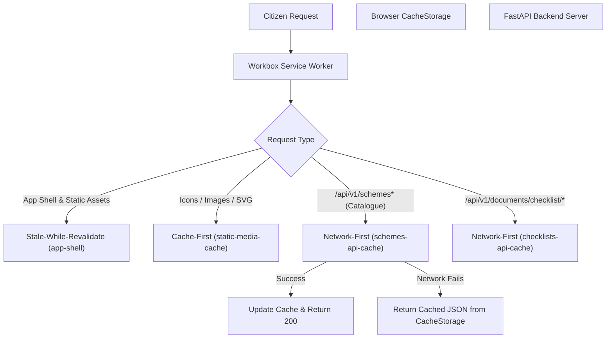

# Scheme Saathi — Progressive Web App (PWA) & Offline Architecture

**Status:** Production Ready  
**Scope:** Frontend PWA, Workbox Service Worker, Offline Scheme Caching, Background Sync Queue  
**Specification Reference:** Phase 13 — Offline & PWA Low-Connectivity Access  

---

## 1. Executive Summary

Scheme Saathi serves citizens across India, with an emphasis on rural and semi-urban populations accessing government welfare services on mobile devices over cellular networks with high latency, intermittent packet loss, or complete cellular dropouts.

Phase 13 establishes a production-grade Progressive Web App (PWA) architecture:
1. **Bilingual Web App Manifest**: Full mobile installability with Devanagari branding (`Scheme Saathi (योजना साथी)`), official theme colors (`#ea580c`), and multi-resolution maskable icons.
2. **Workbox Service Worker Caching**: Production-grade precaching of all app shell assets, fonts, icons, and Network-First caching for scheme catalogues and document checklists.
3. **Client-Side Scheme Fallback**: Reactive offline fallback for scheme discovery (`localStorage.scheme_saathi_cached_schemes`) enabling uninterrupted browsing even without network access.
4. **Offline Application Draft Queue & Background Sync**: Citizens can create and save application drafts offline. These drafts persist in `localStorage.scheme_saathi_offline_drafts` and sync automatically to the backend when an `online` event fires.
5. **Mobile Install Prompt & Offline Status Banner**: Accessible UI components providing transparent feedback on offline mode status and offering installation to the citizen's mobile home screen.

---

## 2. Service Worker & Workbox Caching Strategy

The PWA is configured via `vite-plugin-pwa` in `frontend/vite.config.ts`. In production builds (`npm run build`), Workbox generates `dist/sw.js` and `dist/workbox-*.js` with the following caching policies:



### Runtime Cache Configurations

| Asset / Endpoint Pattern | Strategy | Cache Name | Retention / Expiration | Purpose |
|---|---|---|---|---|
| `**/*.{js,css,html,woff,woff2}` | **Precache / Stale-While-Revalidate** | App Shell | Automatic revision hash | Zero-latency app boot on repeat visits |
| `*.svg`, `*.png`, `icons/*` | **Cache-First** | `static-media-cache` | 60 days, max 100 entries | Emblems, badges, and national UI icons |
| `**/api/v1/schemes*` | **Network-First** | `schemes-api-cache` | 7 days, max 100 entries | Fresh scheme rules online; offline catalogue browsing |
| `**/api/v1/documents/checklist/*`| **Network-First** | `checklists-api-cache` | 7 days, max 50 entries | Critical verification checklists cached offline |

---

## 3. Web App Manifest Specification

The static manifest resides at `frontend/public/manifest.webmanifest` and is referenced in `frontend/index.html`:

```json
{
  "name": "Scheme Saathi (योजना साथी)",
  "short_name": "Scheme Saathi",
  "description": "AI-assisted welfare scheme discovery & application platform for Indian citizens",
  "theme_color": "#ea580c",
  "background_color": "#f8fafc",
  "display": "standalone",
  "orientation": "portrait",
  "start_url": "/",
  "scope": "/",
  "icons": [
    { "src": "/icons/icon-192.png", "sizes": "192x192", "type": "image/png" },
    { "src": "/icons/icon-512.png", "sizes": "512x512", "type": "image/png" },
    { "src": "/icons/icon-512-maskable.png", "sizes": "512x512", "type": "image/png", "purpose": "maskable" },
    { "src": "/icons/icon.svg", "sizes": "any", "type": "image/svg+xml" }
  ]
}
```

---

## 4. Offline Draft Queue & Background Synchronization

When a citizen clicks "आवेदन ड्राफ्ट बनाएं / Create Application Draft" without active internet connectivity:

1. **Local Queue Insertion**: The client generates a local draft record with:
   - `id`: Client-generated UUID (`offline-<timestamp>-<random>`)
   - `scheme_id`: Selected scheme UUID
   - `beneficiary_id`: Selected beneficiary or self
   - `offline_created_at`: ISO timestamp of creation
   - `pending_sync`: `true`
   - `status`: `OFFLINE_DRAFT`
2. **Persistent Storage**: Saved to `localStorage.getItem('scheme_saathi_offline_drafts')`.
3. **Citizen Notification**: A prominent green toast notifies the user:
   - *Hindi*: "ऑफ़लाइन ड्राफ्ट सहेजा गया — इंटरनेट आने पर अपने आप सिंक हो जाएगा।"
   - *English*: "Offline draft saved — will automatically sync when online."
4. **Reconnection Sync**: `OnlineStatusProvider` listens for the `window` `online` event. Upon trigger, `syncPendingDrafts()` iterates through pending drafts, calls `api.applications.createDraft(...)` on the backend, updates local status to synced, and updates the UI in real time.

---

## 5. Automated E2E Verification Suite

Automated verification is provided by `frontend/e2e/pwa_offline.spec.ts` covering:
1. **Manifest Conformance**: Validates HTTP 200, Devanagari branding, theme color, standalone display mode, and icon counts.
2. **Reactive Offline Banner**: Asserts banner appearance on `setOffline(true)` with Hindi copy and disappearance on reconnection.
3. **Offline Navigation Resilience**: Simulates offline mode and tests SPA navigation between `/schemes` and `/` without network errors.
4. **Offline Draft Queueing**: Disconnects network, creates an offline draft, verifies `localStorage` queue integrity, and validates sync recovery.
5. **Install Prompt Handling**: Dispatches simulated `beforeinstallprompt` event and validates display and user dismissal of `InstallPwaPrompt`.
