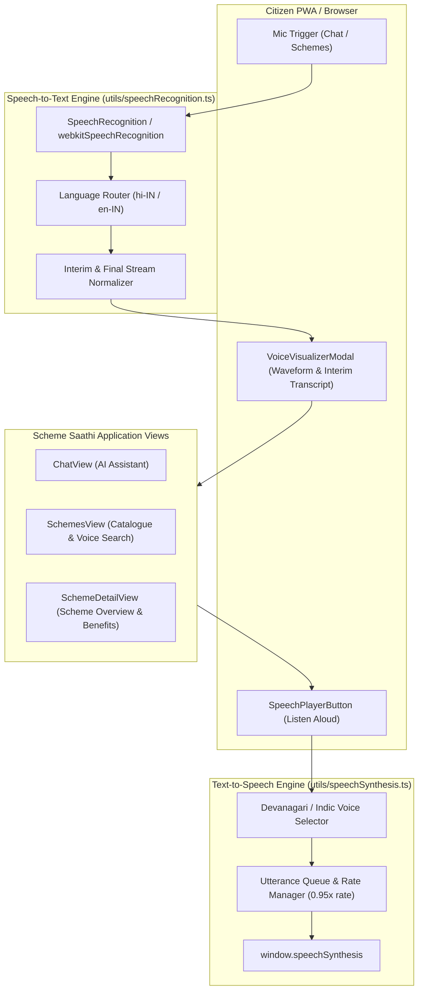

# Scheme Saathi — Voice Accessibility & Speech Integration Guide

**Status:** Production Ready  
**Scope:** Bidirectional Voice Interface, Speech Recognition (STT), Speech Synthesis (TTS)  
**Specification Reference:** Phase 14 — Voice Accessibility for Rural & Low-Literacy Citizens  

---

## 1. Executive Summary

Scheme Saathi is tailored to ensure direct access to government welfare schemes for Indian citizens, specifically targeting rural, semi-urban, and agricultural households where text literacy or typing on mobile touchscreens presents an adoption barrier.

Phase 14 integrates **bidirectional voice interactions** directly in the citizen browser without paid external third-party speech streaming APIs:
- **Speech-to-Text (STT)**: Hands-free voice querying in Hindi (`hi-IN`) and Indian English (`en-IN`) via the browser's native `SpeechRecognition` / `webkitSpeechRecognition`.
- **Text-to-Speech (TTS)**: Localized audio readout of assistant replies, scheme summaries, and eligibility criteria via `window.speechSynthesis`.
- **Voice Search**: Instant voice query filtering in the central welfare schemes catalog.
- **Graceful Fallback**: Comprehensive browser support detection with non-blocking user feedback on browsers without speech hardware permissions.

---

## 2. Architectural Design

---

## 3. Core Modules & Components

### 3.1 Speech Recognition Utility (`frontend/src/utils/speechRecognition.ts`)
- Wraps `window.SpeechRecognition` and `window.webkitSpeechRecognition`.
- Exposes `isSpeechRecognitionSupported()` for defensive runtime capability checks.
- Encapsulates `SpeechRecognizer` class with callbacks: `onStart`, `onInterimResult`, `onFinalResult`, `onError`, `onEnd`.
- Handles both interim stream chunks and final transcript tokens cleanly.

### 3.2 Speech Synthesis Utility (`frontend/src/utils/speechSynthesis.ts`)
- Singleton `speechSynthesizer` providing global control over `window.speechSynthesis`.
- `getMatchingVoice(lang)`:
  - For Hindi (`hi` / `hi-IN`): prioritizes Indian Devanagari voices (`hi-IN`, `"Google हिन्दी"`, `"Lekha"`).
  - For English (`en` / `en-IN`): prioritizes Indian English voices (`en-IN`).
- Default speech rate is calibrated to `0.95x` for optimal clarity and comprehension among rural citizens.
- Auto-cancels in-flight speech when new requests arrive to prevent audio stutter or overlap.

### 3.3 UI Components
1. **`SpeechPlayerButton.tsx`**:
   - Compact speaker icon button (`Volume2` / `VolumeX`).
   - Toggles audio playback on/off with accessible `aria-label` in Hindi and English.
   - Automatically stops playback if unmounted.
2. **`VoiceVisualizerModal.tsx`**:
   - Accessible modal (`role="dialog"`) with animated microphone pulse and audio wave visualizer.
   - Shows live interim transcript in real-time as the citizen speaks.
   - Provides "पूरा हुआ / Done" and "रद्द करें / Cancel" actions.

---

## 4. Integration Points

1. **AI Chat Assistant (`ChatView.tsx`)**:
   - Each assistant message includes a `<SpeechPlayerButton>` in the bubble footer.
   - Header provides an "ऑटो-रीड / Auto-Read" toggle for automatic hands-free audio assistant mode.
   - Microphone button triggers real-time voice input visualizer.
2. **Schemes Catalogue (`SchemesView.tsx`)**:
   - Search input bar includes dedicated microphone button for voice filtering.
   - Each scheme card features a speaker button to listen to the scheme name and key benefits.
   - Quick eligibility modal provides speech playback of the evaluation breakdown.
3. **Scheme Detail (`SchemeDetailView.tsx`)**:
   - Scheme overview card includes prominent audio readout of scheme guidelines, DBT allocations, and eligibility conditions.

---

## 5. Automated E2E Testing Strategy

The test suite (`frontend/e2e/voice_accessibility.spec.ts`) covers:
1. **TTS Speaker Playback**: Validates `speechSynthesis.speak()` invocation, utterance language, and cancellation on second click.
2. **Auto-Read Mode**: Validates automatic audio playback upon arrival of assistant responses.
3. **Voice Input Flow**: Simulates browser `SpeechRecognition` events, verifies real-time modal transcription, and checks message submission.
4. **Voice Catalog Search**: Validates speech transcription directly populates search input and filters cards.
5. **Scheme Details Audio**: Validates speech synthesis playback on scheme details view.
6. **Unsupported Browser Degradation**: Overrides speech APIs and asserts non-blocking warning notification without crashing the application.
